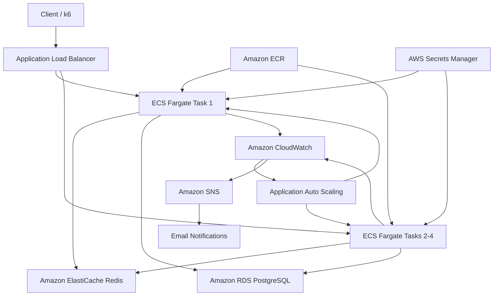

# Cloud Technologies - Laboratory Work 2

## Project description

A containerized FastAPI Notes API deployed on AWS
using Terraform.

The project demonstrates horizontal scaling,
load testing, monitoring, alerting and distributed
Redis caching.

## Technology stack

- Python and FastAPI
- Docker and Docker Compose
- Terraform
- Amazon ECR
- Amazon ECS Fargate
- Application Load Balancer
- Amazon RDS PostgreSQL 16
- Amazon ElastiCache Redis 7.1
- Amazon CloudWatch
- Amazon SNS
- AWS Secrets Manager
- Grafana k6

## Architecture

The application is deployed in eu-north-1.

PostgreSQL and Redis are placed in private subnets.
Access to them is restricted to the ECS security group.

The database password is managed by AWS Secrets Manager.
Redis uses encrypted connections.

## API endpoints

| Method | Endpoint | Description |
|---|---|---|
| GET | /health | Health check |
| GET | /docs | Swagger documentation |
| GET | /notes | List notes |
| GET | /notes/{id} | Retrieve a note |
| POST | /notes | Create a note |
| GET | /redis/stats | Cache statistics |
| POST | /redis/reset | Reset cache and local counters |

Caching can be enabled or disabled using the
use_cache query parameter.

## Local deployment

From the project root:

    docker compose up -d --build

    docker compose ps

Use the published API port shown by docker compose ps
to open the Swagger /docs endpoint.

Stop the local environment:

    docker compose down

## AWS deployment

Prerequisites:

- AWS CLI
- Terraform
- Docker
- Configured AWS credentials
- Correct region and account settings

The Terraform provider configuration is account-specific.
Review main.tf, variables.tf and terraform.tfvars.example
before deploying to another AWS account.

Initialize Terraform:

    cd terraform
    terraform init
    terraform validate

Create the ECR repository:

    terraform apply "-target=aws_ecr_repository.app"

Build, tag and push the application image to the
created ECR repository with the configured image tag.

Deploy the remaining infrastructure:

    terraform plan
    terraform apply

Retrieve the application URL:

    terraform output -raw app_url
    terraform output -raw swagger_url

## Auto Scaling

- Minimum ECS tasks: 1
- Maximum ECS tasks: 4
- CPU target: 60%
- Scale-out cooldown: 120 seconds
- Scale-in cooldown: 300 seconds

## Redis

- Cache-Aside strategy
- TTL: 60 seconds
- Shared cache across ECS tasks
- Cache invalidation after note creation

## Experimental results

| Metric | Without cache | With cache |
|---|---:|---:|
| HTTP requests | 17990 | 18020 |
| RPS | 29.96 | 30.00 |
| Median latency | 552.85 ms | 72.07 ms |
| p95 latency | 1.69 s | 3.23 s |
| Failed requests | 2 | 5 |

Observed cache hit rate: 84.03%.

ECS successfully scaled from one to four tasks.

CloudWatch recorded the alarm transitions:

    OK -> ALARM -> OK

The cache statistics are process-local, and the
database size changed between experiments.
See CACHE.md for detailed experimental limitations.

## Documentation

- [Auto Scaling](docs/AUTOSCALING.md)
- [Load Testing](docs/LOADTEST.md)
- [Monitoring](docs/MONITORING.md)
- [Alerts](docs/ALERTS.md)
- [Redis Caching](docs/CACHE.md)

## Project structure

    app/           FastAPI application
    terraform/     AWS infrastructure
    loadtest/      Cloud load tests and results
    k6/            Additional load tests
    docs/          Technical documentation
    graphs/        Monitoring graphs
    scripts/       Auxiliary scripts

## Cleanup

After saving all results and completing the demonstration:

    cd terraform
    terraform plan -destroy
    terraform destroy
    terraform state list

Destroying the infrastructure removes the cloud database,
cache, application service and related AWS resources.

Terraform state, credentials, private variable files
and deployment plans must not be committed to GitHub.

## Conclusion

The laboratory work demonstrated the deployment and
operation of a scalable AWS application with managed
PostgreSQL and Redis services.

Load testing confirmed horizontal ECS scaling, functional
CloudWatch alerts and working Redis cache invalidation.
The experiments also demonstrated an improvement in
median response latency when caching was enabled,
with limitations affecting the overall comparison.
